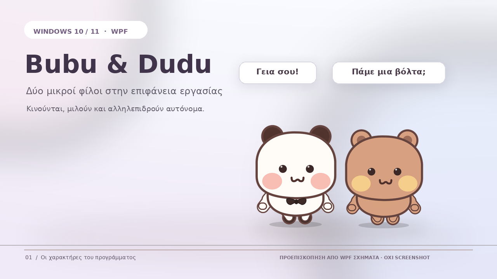
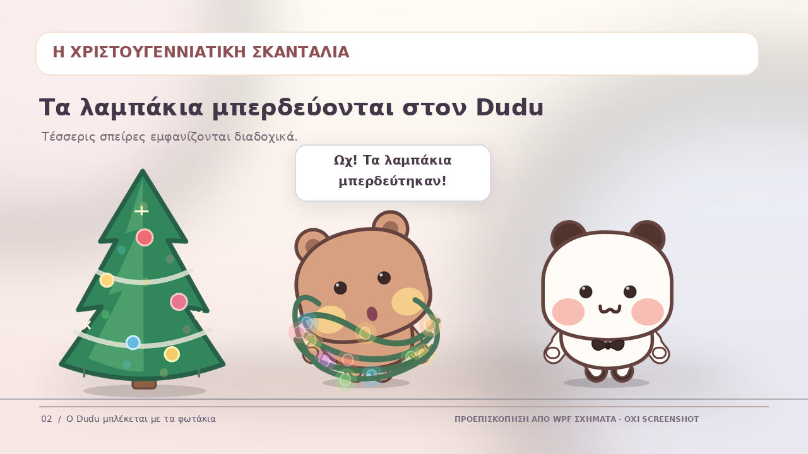
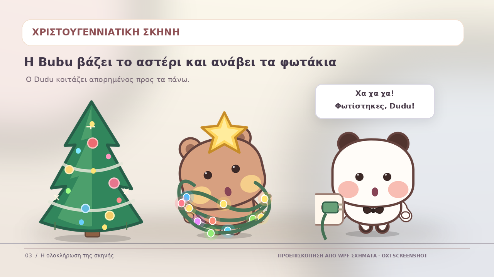

# Bubu & Dudu — Desktop Pet

**Δύο μικροί φίλοι ζωντανεύουν στην επιφάνεια εργασίας των Windows.**

Η **Bubu** και ο **Dudu** είναι δύο κινούμενοι χαρακτήρες που περπατούν, παίζουν, συνομιλούν και αλληλεπιδρούν μεταξύ τους. Δεν χρειάζεται να τους καθοδηγείς: επιλέγουν μόνοι τους τι θα κάνουν, δημιουργώντας μικρές, συχνά αστείες ιστορίες όσο χρησιμοποιείς τον υπολογιστή σου.

## Τι κάνουν

- Περπατούν στην επιφάνεια εργασίας, αλλάζουν κατεύθυνση και αντιδρούν σε όσα συμβαίνουν γύρω τους.
- Μιλούν με ελληνικά συννεφάκια διαλόγου και εκφράζουν διαφορετικά συναισθήματα.
- Αγκαλιάζονται, χορεύουν, παίζουν, ανταλλάσσουν δώρα και ξεκουράζονται.
- Παίζουν μικρές ιστορίες με αντικείμενα, όπως φωτογραφική μηχανή, φορητό υπολογιστή και παιχνίδια.
- Κινούνται σε σχέση με τα ανοιχτά παράθυρα και τις επιφάνειες της οθόνης.
- Επιλέγουν αυτόνομα δραστηριότητες και προσαρμόζουν τις προτιμήσεις τους μέσα από τοπική μάθηση.

## Χριστουγεννιάτικη σκανταλιά

Στη χριστουγεννιάτικη σκηνή, ο Dudu προσπαθεί να στολίσει το δέντρο με λαμπάκια. Όμως το καλώδιο μπερδεύεται και τυλίγεται γύρω του!

Η Bubu τον πλησιάζει, του βάζει ένα χρυσό αστέρι στο κεφάλι σαν να είναι εκείνος η κορυφή του δέντρου, βάζει το φις στην πρίζα και ανάβει τα λαμπάκια. Εκείνη γελάει, ενώ ο Dudu κοιτάζει απορημένος προς τα πάνω.

*Οι εικόνες είναι προεπισκοπήσεις από τα γραφικά WPF/XAML της εφαρμογής, όχι φωτογραφίες από εκτέλεση στα Windows.*

## Εκκίνηση

**Απαιτούνται Windows 10 ή Windows 11**, με το ενσωματωμένο **Windows PowerShell 5.1**. Δεν χρειάζεται εγκατάσταση πρόσθετων βιβλιοθηκών ή σύνδεση στο Internet.

- **`Start.vbs`** — κανονική εκκίνηση, χωρίς ανοιχτό παράθυρο κονσόλας.
- **`Start_Christmas_Demo.cmd`** — εκκίνηση με άμεση παρουσίαση της χριστουγεννιάτικης ιστορίας, μετά τον αρχικό χαιρετισμό.
- **`Start_Debug.cmd`** — εκκίνηση με κονσόλα για εμφάνιση πιθανών σφαλμάτων.

Αποσυμπίεσε τον φάκελο και εκτέλεσε το αντίστοιχο αρχείο. Για να κλείσεις την εφαρμογή, κάνε **δεξί κλικ** σε έναν χαρακτήρα και επίλεξε **Έξοδος**.

## Τεχνολογία

Η εφαρμογή έχει αναπτυχθεί με **PowerShell 5.1 και WPF**. Οι χαρακτήρες σχεδιάζονται με διανυσματικά σχήματα **XAML**, ενώ οι κινήσεις, οι αντιδράσεις και οι διάλογοι υλοποιούνται προγραμματιστικά. Ένας μηχανισμός επιλογής δραστηριοτήτων και τοπική μάθηση τύπου **Q-learning** διαφοροποιούν σταδιακά τη συμπεριφορά τους, χωρίς χρήση διαδικτυακής υπηρεσίας AI.

**Κύριο αρχείο:** `BubuDudu.ps1`  
**Αποθήκευση τοπικής μάθησης:** `%LOCALAPPDATA%\BubuDuduDesktopPet\learning-v1.json`